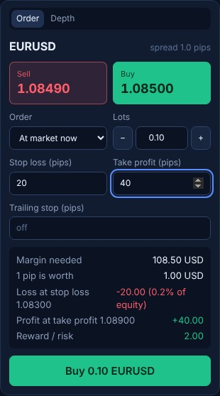
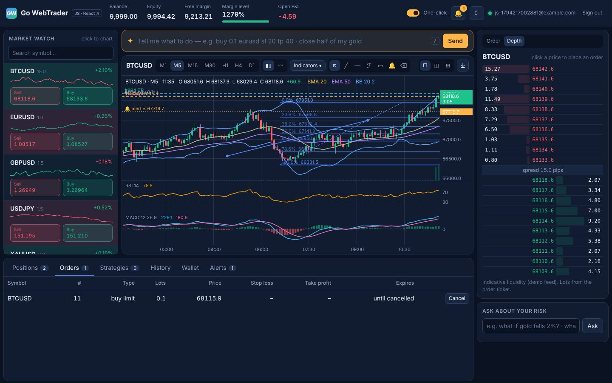
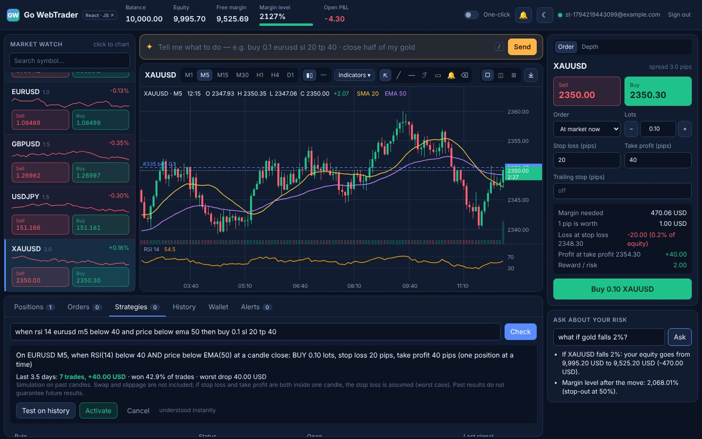
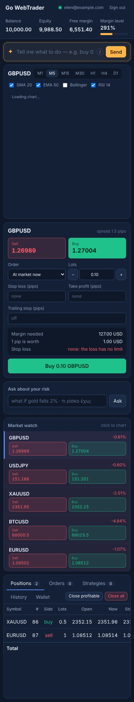

# Go WebTrader

**A web trading platform for brokers, with an AI assistant that runs on the broker's own servers.**

Clients trade in the browser, with no installation. They can type what they want in plain words and see the risk in money before every order. Dealers get one live screen with every client, the broker's exposure and the accounts close to stop-out.

▶ **[Watch the demo (1 minute)](assets/go-webtrader-demo.mp4)**: the JavaScript version, the React version, then the dealing desk.

**Two front-ends, one platform.** The trader screen exists in two versions on the same Go engine: plain JavaScript with no framework, and React. Both share one design, one chart engine and the same trading logic.

This repository is a showcase. The source code is private.

---

## For traders

- **One screen, nothing hidden.** Market watch with live prices, spread, daily change and a mini trend line, the charts, the order ticket, and the positions in tabs. Panels can be resized; dark and light theme.

- **Risk in money, before the order.** Stop loss and take profit are entered in pips. Before the client clicks Buy, the ticket shows:
  - the margin needed and the value of one pip;
  - the loss at the stop loss in dollars and as a % of equity;
  - a warning when there is no stop loss.
- **Everything MT4/MT5 traders expect.** Market and pending orders (limit, stop, expiry), stop loss, take profit, trailing stop, partial close, hedging and netting accounts, swap, commission, margin call and stop-out.
- **One-click trading switch**: off, every quick order asks first; on, it trades at once. Plus *Close profitable* and *Close all*.
- **Depth of market ladder**: click a price to place a limit or stop order at it.
- **Price alerts** from a tab or by clicking a price on the chart. The server watches them, so they keep working when the trader is away, and a **notification arrives on the phone or computer even when the platform is closed**.
- **Works on desktops, tablets and phones.**

## Charts

- **1, 2 or 4 charts on screen**, each with its own symbol and timeframe (M1 to D1); candles or line; save as a picture.
- **Indicators:** SMA, EMA, Bollinger, RSI, MACD, Stochastic, ATR and tick volume, each lower one in its own pane.
- **Drawing tools:** trend line, horizontal line, Fibonacci retracement, rectangle, eraser. Drawings stay in place on every timeframe.
- **A countdown to the candle close** next to the live price, and lines for entries, stop losses, take profits, pending orders and alerts.

## Two versions: JavaScript and React

The same screen, built twice on the same Go server: once in plain JavaScript (no framework, no build step) and once with React components. They share the styles, the chart engine and the trading logic, so they look and behave the same.

## The AI assistant

- **Orders in plain words.** *"buy 0.1 eurusd sl 20 tp 40"*, *"close half of my gold"*, *"trailing 15 on my sells"*. It understands English and Greek, and more languages can be added. The assistant shows exactly what will happen, with pips already turned into prices, and **nothing runs until the client clicks Confirm**.
- **Strategies without code, instead of Expert Advisors.** *"when RSI 14 on EURUSD M15 falls below 30 and the price is above the EMA 200, buy 0.1 with a 20 pip stop"*. The client tests the strategy on recent history (number of trades, profit, win rate, worst drop) before activating it. Once active, plain code checks it at every candle close, and the AI takes no part in trading.
- **Risk questions.** *"what if gold falls 2%?"*, *"what is my risk?"*. The platform computes every number with the same formulas as the trading engine, including the stop losses that would close positions on the way. The AI only reads the question.
- **Your model, your servers.** The assistant uses an open-source model on the broker's own hardware (Ollama, llama.cpp or vLLM). Client data never leaves the broker. Common commands are understood instantly by built-in rules, so they work even when the model is offline.

## For the dealing department

- **Every client, live:** who is trading, open positions, balances, and the floating profit or loss of clients and of the broker.
- **Broker exposure per symbol** (B-book): the clients' net long or short position and its value.
- **Clients closest to stop-out,** with margin call and near-stop-out flags.
- **Latest trades of all clients,** with stop-outs highlighted.
- **Back office:**
  - withdrawals with four-eyes approval, so nobody approves their own;
  - an append-only ledger;
  - one-click reconciliation of every balance against the ledger.

## Built for real money

- **Nothing is lost.** Every change is written to disk before it is confirmed, and after a restart or a power cut the platform comes back exactly as it was.
- **Fast.** Opening and closing a position takes microseconds in memory, and well under a millisecond including the safe write to disk.
- **No double trades:** a retried click or a reconnect never opens a second position.
- **Money is counted in whole cents,** never in floating point.
- **PostgreSQL reporting copy** for back office, CRM and reports, filled in the background so trading never waits for it.
- **Installed on the broker's own servers:** a single program that needs no outside services.

## Phone

---

*Prices in the demo come from a built-in simulator, and the other clients are simulated accounts trading on their own.*
